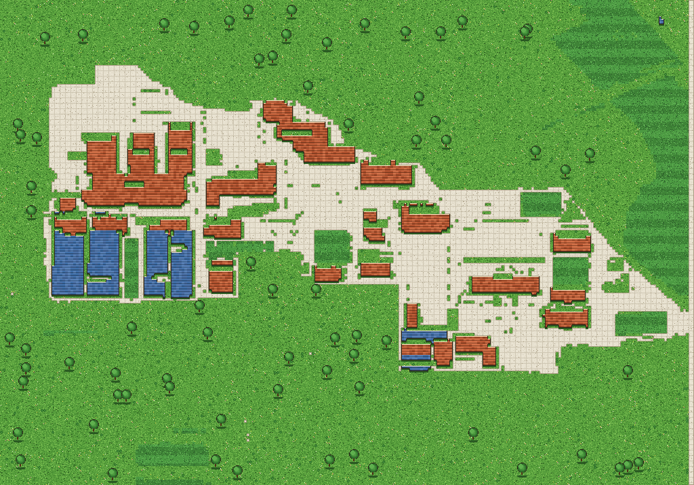

# 像素校园 · 延边大学（延吉校区）

用代码把延边大学延吉校区画成一张「星露谷风」像素地图：道路、建筑、绿地全部由程序生成，可缩放浏览。

## 预览



## 特性

- 按《延边大学建筑分布图》还原道路与建筑
- 星露谷像素风：草地噪点、花丛、树、瓦楞屋顶、铺装碎石
- 分块烘焙渲染（4×3 块，256×256），运行时只做 `drawImage`
- 建筑信息层：自动从网格里认出 25 栋楼，鼠标悬停高亮、点击查看编号与尺寸
- 响应式布局，适配手机屏幕
- 缩放 50% ~ 400%
- 纯前端，无后端依赖

## 快速开始

```bash
npm install
npm run dev
```

打开 http://localhost:5173/

## 目录结构

```
src/
  pixel.js       像素绘制库（颜色打包 / setPixel / 帧缓冲）
  mapdata.js     类别网格数据（由建筑分布图生成）
  ground.js      地面渲染（草地 / 铺装 / 绿地 / 建筑）
  chunk.js       分块烘焙与缓存
  buildings.json 建筑清单（25 栋，含 id / 格坐标 / 尺寸 / 名字，由脚本生成）
  inspect.js     建筑信息层（连通域拾取 + 高亮 + 文案）
  main.js        页面装配与交互
tools/
  render-preview.mjs    生成 docs/preview.png 并校验分块拼装
  extract-buildings.mjs 从类别网格提取建筑清单
  png.mjs              极简 PNG 编码器
docs/          预览图
public/        静态资源
```

## 数据是怎么来的

1. 以《延边大学（延吉校区）建筑分布图》为源图
2. 按颜色分类：白色→铺装/道路、绿色→绿地、米黄→教学楼、蓝→宿舍
3. 降采样成 256×179 的类别网格（`src/mapdata.js`）
4. 渲染时逐格绘制星露谷风材质
5. 对类别网格做连通域分析，把「连成一片的教学/宿舍格」认成一栋楼 → `src/buildings.json`

重新生成预览图 / 建筑清单：

```bash
node tools/render-preview.mjs
node tools/extract-buildings.mjs   # 改了 mapdata 之后要重跑
```

## 下一步（欢迎认领）

- **给 25 栋楼起名和写简介**：`src/buildings.json` 里每条都有 `name` / `intro` 两个 `null`，
  填上就会在地图下方的信息面板里显示。这是目前最缺、也最不需要写代码的一项。
- **接入建筑立面贴图**：`public/buildings/` 里已经有 23 张手绘立面（64px 高）和 `manifest.json`，
  但还没接进渲染管线；且 manifest 里的格坐标和现在的 mapdata 对不上，需要按连通域重新绑定。
- **走动与联机**：现在 1 格 ≈ 4~5 米，人比一个格子还小，做不了「走进去」；
  需要更细的地图数据（1 格 ≈ 1 米）再上镜头和角色。

## 参与贡献

1. Fork 本仓库
2. 新建分支：`git checkout -b feature/your-feature`
3. 提交：`git commit -m "feat: 你的改动"`
4. Push 并开 Pull Request

欢迎提 Issue 讨论想法。

## License

MIT
